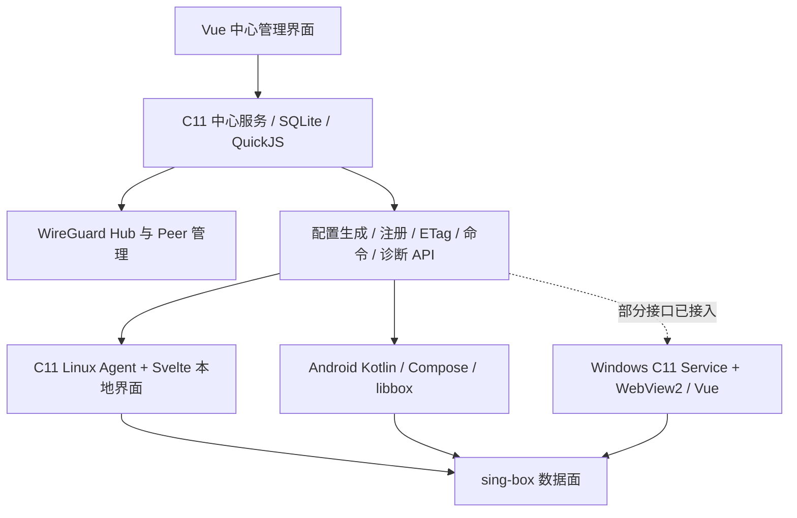

# sb-easy 产品现状、竞品与功能缺口评估

评估日期：2026-10-23。代码基线：`c2f3bc9`（`master` / `origin/master`）。

这是实施前的基线评估，以下“当前”“未实现”均对应上述提交。后续功能、版本、测试证据及仍待平台验收的项目见[功能补齐实施记录](feature-completion.md)；实际下载版本见[发布清单](../config/client-releases.json)。

本次结合实际代码、现有测试、官方产品文档、官方仓库和应用商店资料。覆盖桌面、移动、Apple 生态、管理面板和网关的主要产品路线，不能声称穷尽所有商业产品、地区版本和社区分支。竞品能力是官方资料核验，未逐个安装实测；部分依据当前主分支文档，正式包以对应发行说明为准。预览、实验性和停止维护状态单独标注。

## 1. 核心结论

sb-easy 已经具备“自托管中心管理 + WireGuard 网络 + sing-box 执行 + 受管客户端”的完整架构。多主机、规则生成、实时监控、设备注册、配置回滚、Android 网络恢复等已经实现。它的价值主要在统一管理多台设备、集中配置和诊断。

目前最影响产品完整性的差距是：

1. **Windows 中心管理流程尚未闭合**：界面自动刷新不等于中心配置自动同步，缺少与 Android/Linux 对齐的心跳、命令处理和回执；核心故障后也没有完整自动恢复。
2. **首次使用依赖中心**：Android 没有本机订阅导入入口；Windows 虽有本机订阅，仍必须先注册并获得中心配置。已有缓存的离线运行不等于无需中心的独立模式。
3. **跨端分流和诊断不一致**：Android 已有自定义域名组、主动测速和真实 URL 路由测试；Windows 主要覆盖中心已有分组、展示已有测速结果。
4. **订阅、升级和发布体验不完整**：订阅自动更新/余量提示、导入兼容性说明、应用与内核更新、插件升级回滚、正式签名和统一版本展示均需完善。
5. **平台覆盖有空白**：没有自有 iOS/macOS/tvOS 客户端，也没有面向普通用户的 Linux 原生桌面客户端；Linux Agent + Web UI 已存在。

建议优先做强“可靠的受管客户端”，再决定是否扩展独立客户端模式。完整 MITM、机场计费、多内核和所有新协议不应抢占可靠性、同步和诊断的优先级。

## 2. 版本同步与升级边界

已执行 `git fetch origin --tags`，随后 `git rev-list --left-right --count HEAD...origin/master` 返回 `0 0`。本地源码已经是远端主分支最新提交，无需合并。原有未跟踪的下载产物和 `tmp/` 未处理。

| 组成 | 当前代码版本 | 证据 / 解释 |
| --- | --- | --- |
| 仓库 | `c2f3bc9`，2026-10-13 | 最新主分支提交：撤回 Android 抓包并发布 1.3.4 |
| C 服务端 / Linux Agent | CMake `1.0.0`，功能以提交为准 | [c/CMakeLists.txt](../c/CMakeLists.txt#L3)；不能用这个长期不变的版本号判断线上代码新旧 |
| Android | `1.3.4`，versionCode 28 | [app/build.gradle.kts](../android/app/build.gradle.kts#L16)，标签 `android-v1.3.4` |
| Windows | `0.6.9` 预览 | [windows/CMakeLists.txt](../windows/CMakeLists.txt#L2)，标签 `windows-v0.6.9-preview.1` |
| 项目固定 sing-box | `1.13.12` | [Dockerfile](../Dockerfile#L43)、[统一 Agent](../c/Dockerfile.unified#L16)、[Android 构建脚本](../android/scripts/build-libbox.sh#L4)、[Windows 准备脚本](../windows/scripts/prepare-core.ps1#L11) |
| 上游 sing-box 稳定发布 | `1.14.3`，2026-10-09 | [官方发布记录](https://github.com/SagerNet/sing-box/releases/tag/v1.14.3)；与项目固定版本不同 |

本次版本同步指本地项目源码，不代表已更新运行中的服务器、用户手机或 Windows 安装包。没有部署、重启生产服务或修改生产数据库，也没有将所有依赖批量升级。

内核从 1.13.12 升至 1.14.3 应作为独立兼容性变更处理：同时更新版本、源码 revision 和 Windows 下载摘要；检查 Android libbox API/本地 overlay、Go bridge、DNS/规则行为和回滚；不能只改一个版本字符串。上游有明确的 [1.14 迁移说明](https://sing-box.sagernet.org/migration/)，本项目 [既往 DNS 验证记录](../c/PROGRESS.md)也表明 `sing-box check` 通过仍可能在实际启动时失败。

## 3. 当前架构与已实现能力

当前原生服务代码以 `c/`、`windows/` 为准；`cpp/`、Rust `backend/` 和 `agent/` 是历史参考，不应将其未实现项或旧 bug 直接算到当前版本。参见 [C 开发约定](../c/CONVENTIONS.md)。

| 能力 | 已核实状态 | 代码 / 文档证据 |
| --- | --- | --- |
| 多主机、配置模板、QuickJS | 已有 managed/full 配置、脚本测试和结果来源；不能列为缺失 | [config_renderer.c](../c/src/config_renderer.c)、[script_engine.c](../c/src/script_engine.c)、[ProfilesView.vue](../frontend/src/views/ProfilesView.vue) |
| 设备注册与撤销 | 一次性注册、每设备 token、主机禁用和 token 轮换已有 | [http_routes_hosts.c:806](../c/src/http_routes_hosts.c#L806)、[注册接口](../c/src/http_routes_hosts.c#L907) |
| 中心观测 | WebSocket 流量/连接/日志、代理组切换、配置漂移、命令 API 已有 | [clash_websocket.c](../c/src/clash_websocket.c)、[MonitorView.vue](../frontend/src/views/MonitorView.vue)、[命令接口](../c/src/http_routes_hosts.c#L633) |
| WireGuard 用户管理 | Peer、二维码、握手/流量、配额、到期、主机网络已有；这不是代理协议账号的跨节点配额体系 | [wireguard.c](../c/src/wireguard.c)、[ClientsView.vue](../frontend/src/views/ClientsView.vue) |
| 基础平台管理 | admin/viewer、审计、备份/恢复、中英文、深色模式已有 | [http_routes_admin.c](../c/src/http_routes_admin.c)、[UsersView.vue](../frontend/src/views/UsersView.vue) |
| 配置候选与回滚 | Android 和 Windows 均有校验、候选/当前配置、失败保留或恢复；不是应用二进制升级回滚 | [AtomicConfigStore.kt](../android/core/src/main/java/io/sbeasy/android/core/AtomicConfigStore.kt)、[controller.c:410](../windows/service/controller.c#L410) |
| Android 网络可靠性 | Always-on 声明、sticky 服务、切网防抖、reset/重建、watchdog 已有；真机覆盖仍应单独验收 | [Manifest:65](../android/app/src/main/AndroidManifest.xml#L65)、[SbEasyVpnService.kt:107](../android/libbox-bridge/src/main/java/io/sbeasy/android/libbox/SbEasyVpnService.kt#L107)、[恢复逻辑](../android/libbox-bridge/src/main/java/io/sbeasy/android/libbox/SbEasyVpnService.kt#L324) |
| Android 路由与诊断 | 默认/Claude/GPT/自定义域名组、固定出口、节点测试、真实 URL 路由测试、流量统计已有 | [LocalRoutingPolicy.kt](../android/core/src/main/java/io/sbeasy/android/core/LocalRoutingPolicy.kt)、[AgentRepository.kt:270](../android/core/src/main/java/io/sbeasy/android/core/AgentRepository.kt#L270) |
| Windows 服务分流 | 可覆盖默认、GPT、Claude和中心已有简单域名组的出口/DNS；不能任意新建和编辑域名组 | [routing_groups.c:60](../windows/service/routing_groups.c#L60)、[ServiceRouting.vue](../windows/ui/src/components/ServiceRouting.vue) |
| Windows 本机订阅 | 已支持 URL、手动刷新/删除、Clash YAML、sing-box JSON、普通/Base64 URI；仅导入节点，不完整迁移路由/DNS/脚本 | [subscriptions.ts:81](../windows/ui/src/lib/subscriptions.ts#L81)、[subscriptions.c](../windows/service/subscriptions.c) |
| Windows 可观测性 | 运行时流量、连接、日志、诊断包；可选统计插件；连接采样可能遗漏短流/结束尾部 | [ANDROID-PARITY.md](../windows/ANDROID-PARITY.md)、[diagnostics.c](../windows/service/diagnostics.c) |
| Windows 抓包/HTTPS 调试 | 可选 PCAP 与 mitmproxy 插件已有；HTTP/3、证书固定和进程归因存在已知边界 | [HTTP 调试说明](../extensions/http-debug/README.md) |
| Android 抓包/HTTPS 调试 | **1.3.4 已撤回**，保留旧文件不代表当前可用；普通统计/日志保留 | [Android 1.3.4 说明](../android/README.md#134--packet-capture-temporarily-withdrawn)、[运行时禁用](../android/libbox-bridge/src/main/java/io/sbeasy/android/libbox/SbEasyVpnService.kt#L279) |
| 凭据保护 | Android Keystore；Windows DPAPI/ACL、管道身份验证、向 WebView 输出脱敏配置已有 | [SecureEnrollmentStore.kt](../android/core/src/main/java/io/sbeasy/android/core/SecureEnrollmentStore.kt)、[secure_store.c](../windows/service/secure_store.c)、[pipe_server.c](../windows/service/pipe_server.c) |

协议能力应分成“内核能运行、导入器能解析、界面能编辑、平台包已编译支持”四层。中心 URI 导入分支覆盖 SS、VMess、VLESS、Trojan、Hysteria2、TUIC，结构化导入另有 HTTP；Windows 导入器还支持 SOCKS。不能据此宣称完整支持所有 sing-box 协议。证据：[中心解析器](../c/src/proxy_parser.c#L632)、[结构化导入](../c/src/proxy_parser.c#L2141)、[Windows 限制](../windows/ui/src/lib/subscriptions.ts#L4)。full JSON 是高级入口，仍受各端运行时校验和编译能力约束。

## 4. 市场产品地图

### 4.1 桌面与跨平台客户端

| 产品 / 官方来源 | 平台与定位 | 值得对照的能力或限制 |
| --- | --- | --- |
| [Clash Verge Rev](https://github.com/clash-verge-rev/clash-verge-rev) | Windows/macOS/Linux，Mihomo GUI | 系统代理守卫、TUN、Merge/Script、规则编辑、WebDAV |
| [Clash Party（原 Mihomo Party）](https://github.com/mihomo-party-org/clash-party) | 桌面 Mihomo GUI | 订阅覆写、Sub-Store、WebDAV；Smart Core 选线属于产品自述，未实测其收益 |
| [Clash Nyanpasu](https://nyanpasu.org/introduction/) | Windows/macOS/Linux | 配置处理链、差异/快照、连接分析；本次 latest 为 2.0.0-rc.2，不能省略候选版标识 |
| [v2rayN](https://github.com/2dust/v2rayN) | Windows/Linux/macOS，多内核 GUI | 节点/分享链接/订阅工作流；不能再按“仅 Windows”比较 |
| [Throne](https://github.com/throneproj/Throne) | 跨平台 Qt，延续 NekoRay 路线 | sing-box、Xray 自定义配置、链式出站、订阅/深链接 |
| [NekoRay](https://github.com/MatsuriDayo/nekoray) | Windows/Linux 历史产品 | 原仓库 2025-03-17 归档并声明不再维护，作为历史参考 |
| [Hiddify App](https://github.com/hiddify/hiddify-app) | Android/iOS/Windows/macOS/Linux | 自动选节点、订阅自动更新、流量/到期、格式兼容、TUN |
| [Karing](https://github.com/KaringX/karing) | Windows/macOS/Linux/Android/iOS/tvOS | 多订阅共用规则、新手模式、iCloud/LAN/WebDAV/ZIP 同步 |
| [FlClash](https://github.com/chen08209/FlClash) | Android/Windows/macOS/Linux，Mihomo | 配置覆写、连接/DNS/日志、WebDAV、Android 应用分流/快捷磁贴/自动化 |
| [Clash Mi](https://github.com/KaringX/clashmi) | Android/iOS/macOS/Windows/Linux，Mihomo | 标准 YAML 和集成 zashboard；与 Karing 是不同内核的产品 |
| [sing-box 官方客户端](https://sing-box.sagernet.org/clients/) | Android、Apple 和 Desktop 三条客户端 | [Desktop 已有 Windows/Linux GUI](https://sing-box.sagernet.org/clients/desktop/)，管理本地/远程配置并运行 TUN |
| [ClashX.Meta](https://github.com/MetaCubeX/ClashX.Meta) | macOS | 菜单栏、配置切换、规则、URL Scheme；与旧 ClashX/重打包版本分开识别 |
| [v2rayA](https://github.com/v2rayA/v2rayA) | 服务 + 浏览器控制台，桌面/路由器/NAS | 透明代理、订阅、节点组和 RoutingA；是 Linux 本地管理界面的直接参照 |
| [Proxifier](https://www.proxifier.com/) | Windows/macOS，官网另列 Android | 应用/目标分流、SOCKS/HTTPS、代理链、远程配置；不是同类订阅内核管理器 |

### 4.2 移动端与 Apple 生态

上表的 Hiddify、Karing、FlClash、Clash Mi、sing-box 同样属于移动端对照范围，下表补充其余路线。

| 产品 / 官方来源 | 平台与定位 | 值得对照的能力或限制 |
| --- | --- | --- |
| [Clash Meta for Android](https://github.com/MetaCubeX/ClashMetaForAndroid) | Android | Clash.Meta 配置生态、规则隧道、F-Droid；勿与旧 Android 分支混淆 |
| [v2rayNG](https://github.com/2dust/v2rayNG) | Android，Xray/v2fly | 节点/路由、GeoIP/GeoSite，发行文件 GPG 校验说明 |
| [NekoBox for Android](https://github.com/MatsuriDayo/NekoBoxForAndroid) | Android，sing-box | 多协议/插件；订阅只提取节点，忽略源分流；官方警告同名 Play 版本被第三方控制 |
| [Husi](https://github.com/xchacha20-poly1305/husi) | Android，并有桌面构建说明 | 后台核心、TUN 服务、协议插件、可复现 Android 构建；桌面架构支持不完全相同 |
| [Shadowrocket](https://apps.apple.com/us/app/shadowrocket/id932747118) | 商店列 iPhone/iPad/Mac/Apple TV | 规则、DNS/流量记录、MITM、重写/脚本、多级转发；Mac 兼容上架不等于独立 Mac 原生产品 |
| [Surge](https://manual.nssurge.com/book/understanding-surge/en/) | iOS/macOS | 智能策略、DNS、抓包/重写/脚本；Mac 网关、远程 Dashboard、Ponte；属于专业网络工具，另见 [Mac 发布记录](https://www.nssurge.com/support/mac/release-notes/) |
| [Quantumult X](https://apps.apple.com/us/app/quantumult-x/id1443988620) | 商店列 iPhone/iPad/Mac/Apple TV | TUN、请求/响应记录、MITM/重写、自定义 DNS/策略过滤 |
| [Loon](https://apps.apple.com/us/app/loon/id1373567447) | iPhone/iPad/Apple TV | 抓包、HTTP/2 MITM、规则/脚本、DNS 记录、IPv6；商店提示未验证 macOS |
| [Stash](https://stash.ws/download) | iOS/tvOS/macOS；Android early access、Windows early build | YAML、策略、脚本/调试、测速/诊断；Android/Windows 仍属早期版本，不能宣称各端等价 |
| [Streisand](https://apps.apple.com/us/app/streisand/id6450534064) | iPhone/iPad | 多协议、规则和自定义 DNS，偏易用连接工具 |
| [Egern](https://apps.apple.com/us/app/egern/id1616105820) | iPhone/iPad | 自动测试/回退/负载均衡、MITM/脚本、iCloud 同步 |
| [Happ](https://github.com/Happ-proxy/happ-desktop) | Android/iOS，另有 Windows/macOS/Linux | Xray 客户端；[服务提供者文档](https://docs.happ-proxy.com/)另有远程设置/设备统计，适合比较服务分发流程 |
| [OneBox 产品族](https://www.sing-box.net/en) | 官网列桌面、iOS/iPadOS、Android | 本次只核实产品/下载平台；此域名是第三方产品站，不是 SagerNet 官方站 |

### 4.3 自托管控制面板、网关和运行控制台

| 产品 / 官方来源 | 定位 | 对 sb-easy 的参照价值 |
| --- | --- | --- |
| [wg-easy](https://github.com/wg-easy/wg-easy) | WireGuard 自托管管理 | Peer/QR/到期之外，重点比较 2FA、OIDC、Prometheus、按客户端防火墙 |
| [3x-ui](https://github.com/MHSanaei/3x-ui) | Xray 多用户/多节点管理 | 代理用户配额/到期/设备限制、订阅转换、API 权限；当前文档已含多节点 |
| [Marzban](https://github.com/Gozargah/Marzban) | Xray 用户与节点管理 | 周期额度、订阅、API/CLI/机器人；多管理员在 README 仍标 WIP |
| [Hiddify Manager](https://github.com/hiddify/Hiddify-Manager) | Xray/sing-box 管理 | 用户专属页、域名、备份/更新、管理员和客户端整合 |
| [S-UI](https://github.com/alireza0/s-ui) | sing-box 管理 | 多客户端/入站、路由 GUI、流量、link/JSON/Clash 订阅；最接近的服务端参照之一 |
| [OpenClash](https://github.com/vernesong/OpenClash) | OpenWrt/Mihomo 网关 | 多订阅、转换/覆写、TUN、DNS、防火墙和访问控制 |
| [PassWall](https://github.com/Openwrt-Passwall/openwrt-passwall) | OpenWrt LuCI 代理生态 | 网关部署和多组件整合；本次未完成 PassWall2 的独立逐项验证 |
| [MetaCubeXD](https://github.com/MetaCubeX/metacubexd)、[zashboard](https://github.com/Zephyruso/zashboard)、[yacd](https://github.com/haishanh/yacd) | Clash/Mihomo 运行控制台 | 比较连接、日志和组切换；不把它们等同于安装/账号/多主机管理平台 |

### 4.4 相邻路线与边界

| 产品 / 来源 | 可借鉴的部分 | 比较边界 |
| --- | --- | --- |
| [Tailscale](https://tailscale.com/features)、[NetBird](https://docs.netbird.io/manage/network-routes) | 设备/身份/访问策略、出口节点、私网路由 | 组网和零信任路线，不是订阅规则代理客户端；本次仅作定位对照 |
| [Outline](https://developer.getoutline.org/concepts/) | Manager/Client 分工、邀请和 access key 首次连接 | 简化服务领取与入门，不以复杂策略/调试见长 |
| [Mullvad](https://mullvad.net/en/why-mullvad-vpn) | 断线保护、应用分流、多跳等可靠性体验 | 属于包含节点服务的商业 VPN；不能据客户端功能表推断 sb-easy 需要经营节点网络 |
| [wireproxy](https://github.com/windtf/wireproxy) | WireGuard 转 SOCKS 的组合方式 | 桥接工具，不是完整管理平台 |
| [tun2socks](https://github.com/xjasonlyu/tun2socks) | TUN 到代理的透明转发 | 数据面组件；不提供完整订阅、账号、同步和 GUI |

商业 VPN、企业代理、安全网关、调试代理与浏览器代理扩展还有大量产品。本次重点是与 sb-easy 功能选择有关的路线，未逐项评估所有商业套餐、地区供应商和同名重打包应用。未核实产品不计为“缺失”证据。

### 4.5 应持续关注的变化

官方 sing-box 已提供 Desktop 图形客户端，并在 **1.14.0 起提供 API 服务与 Dashboard，支持 Apple/Android 客户端远程控制运行实例**。这已有正式文档依据，不只是早期预发布公告。它会缩小“包一层内核监控界面”的差异空间；sb-easy 更应突出设备管理、配置发布、权限、回滚和多主机一致性。来源：[API 服务](https://sing-box.sagernet.org/configuration/service/api/)、[Desktop](https://sing-box.sagernet.org/clients/desktop/)。

发布状态需要与平台能力分开。例：[Nyanpasu 2.0.0-rc.2](https://github.com/libnyanpasu/clash-nyanpasu/releases/tag/v2.0.0-rc.2)是候选版；[Stash Android/Windows](https://stash.ws/download)是早期构建；NekoRay 原仓库明确停止维护。单凭搜索热度、仓库推送时间或旧 release 日期，不能判定其他产品已停止维护。

## 5. 功能缺口与优先级

P0 表示面向更广泛用户发布前的门槛；P1 表示当前核心体验优先项；P2 为扩展能力或定位相关项。代码中“未发现”是本次静态审查结果，不代替运行时安全证明。

| 优先级 | 缺口与现有基础 | 建议交付与验收标准 | 主要证据 / 对照 |
| --- | --- | --- | --- |
| P0 | 发布信任与安全默认值不完整。已有 Keystore/DPAPI，但客户端接受 HTTP 管理地址；Android 文档标注测试签名，Windows 为未签名预览 | 正式发布签名与安装包校验；新注册默认 HTTPS，开发/局域网 HTTP 为明确配置；验证 token/配置传输、升级身份连续性 | [Android Manifest:37](../android/app/src/main/AndroidManifest.xml#L37)、[EnrollmentUriParser.kt:29](../android/core/src/main/java/io/sbeasy/android/core/EnrollmentUriParser.kt#L29)、[Windows URL 校验](../windows/service/runtime_config.c#L130)、两端 README |
| P0 | 防泄漏验收不完整。Android Always-on 已有，但不是系统 lockdown 已启用的证明；Windows 未见独立 kill switch | 可选断线阻断及清晰的失败策略；验证核心崩溃、重启、切网、休眠、DNS/IPv6/UDP。明确允许直连例外和控制面恢复路径 | [controller.c:314](../windows/service/controller.c#L314)、Android Manifest；[Mullvad](https://mullvad.net/en/why-mullvad-vpn)作为体验参照 |
| P1 | Windows 中心配置/设备状态/命令流程不完整；自动刷新只读本地状态 | 后台定时 ETag 同步、心跳/版本、命令轮询/ACK、遥测；关闭 UI 后继续，配置变更在声明时限内生效，失败可定位并保留可用配置 | [control_plane.h:16](../windows/service/control_plane.h#L16)、[controller.c:909](../windows/service/controller.c#L909)、[App.vue:619](../windows/ui/src/App.vue#L619)；Android [AgentRepository.kt:153](../android/core/src/main/java/io/sbeasy/android/core/AgentRepository.kt#L153)已有闭环 |
| P1 | Windows 自动连接/恢复不完整；服务启动不代表 VPN 连接，核心失败后清 active 并报错 | 用户可配置开机连接；网络变化/睡眠恢复/核心退出后有退避重试、健康探测和可解释状态；用户手动断开应抑制自动重连 | [controller.c:314](../windows/service/controller.c#L314)、[Package.wxs:41](../windows/installer/Package.wxs#L41)、[Windows README](../windows/README.md) |
| P1，定位相关 | 独立使用不足。Windows 本机订阅需先 enroll/共享配置；Android 无订阅入口 | 如果目标包含普通个人用户：支持“独立/受管”双模式、空安装导入订阅即用、离线启动；如果坚持受管定位，应明确入口并简化中心部署/注册 | [subscriptions.c:54](../windows/service/subscriptions.c#L54)、[controller.c:702](../windows/service/controller.c#L702)、[Android 缓存启动](../android/libbox-bridge/src/main/java/io/sbeasy/android/libbox/SbEasyVpnService.kt#L198)；Hiddify/Karing |
| P1 | 订阅体验和兼容性不齐。中心已有刷新间隔，Windows 为手动更新；未见套餐余量/到期展示 | Windows 后台定时更新、失败保留旧节点；解析流量/到期元数据；导入输出成功/跳过/原因，订阅刷新保留本地策略；发布跨端格式/协议矩阵 | [中心订阅页](../frontend/src/views/SubscriptionsView.vue)、[Windows 解析器](../windows/ui/src/lib/subscriptions.ts)、[SubscriptionsPanel.vue](../windows/ui/src/components/SubscriptionsPanel.vue)；Hiddify/Throne |
| P1 | 本地分流模型不一致。Android 自定义域名组较完整；官方应用匹配仅内置 Claude/ChatGPT；Windows 只能覆盖中心已有组 | 统一可导出策略结构，任意域名/应用或进程分组；明确中心策略与本地覆盖优先级；DNS 与数据流选择一致；更新中心配置不丢本地配置 | [LocalRoutingPolicy.kt:43](../android/core/src/main/java/io/sbeasy/android/core/LocalRoutingPolicy.kt#L43)、[routing_groups.c:125](../windows/service/routing_groups.c#L125)；FlClash/Proxifier |
| P1 | 策略选择已有 urltest/selector 基础，但缺少用户可控的健康策略产品层 | 配置探测间隔/超时/容差、失效切换和固定出口失败行为；不要将用户指定地区/固定 IP 偷换成任意可用节点；负载均衡按需求另定 | [中心默认 urltest 24h](../c/src/config_renderer.c#L420)、[Android 节点限制](../android/core/src/main/java/io/sbeasy/android/core/LocalRoutingPolicy.kt#L40)；Surge/Egern |
| P1 | Windows 缺主动测速/真实 URL 路由测试，已有连接展示不足以解释失败 | 对齐 Android 测速与真实请求探测；输出进程/域名、命中规则、DNS、选择链和实际出口；脱敏诊断包可导出/按用户操作上报 | [protocol.c](../windows/service/protocol.c)、[Android AgentRepository.kt:270](../android/core/src/main/java/io/sbeasy/android/core/AgentRepository.kt#L270)；Surge/Stash/FlClash |
| P1（公网/团队） | 基础 RBAC 已有；未见 MFA/OIDC、细粒度设备组权限和会话管理产品流程 | MFA/OIDC、管理员/操作员/只读和设备组范围；沿用已有 token 轮换/禁用；验证撤销后行为。不要重复开发已经存在的轮换 API | [auth.c](../c/src/auth.c)、[UsersView.vue](../frontend/src/views/UsersView.vue)、[rotate-token](../c/src/http_routes_hosts.c#L806)；wg-easy |
| P1 | 内核与发布版本分散，缺完整自更新流程 | 建立统一 release manifest、平台/架构/应用/内核/协议版本矩阵；先做更新提醒与可信下载，再做签名验证、配置迁移、灰度及二进制回滚 | 四处 1.13.12 固定版本；MSI 升级能力不等于应用内更新器；上游 1.14 迁移说明 |
| P2 | 中心下发不等于本地偏好同步；自定义组/节点选择/本地订阅各端独立保存 | 可加密导入导出、本地配置漫游、冲突提示和按端排除；不能覆盖设备专属路由与凭据 | [LocalRoutingStore.kt](../android/core/src/main/java/io/sbeasy/android/core/LocalRoutingStore.kt)、[subscriptions.c:75](../windows/service/subscriptions.c#L75)；Karing/FlClash |
| P2 | 插件是固定可信目录下载器，已有 SHA256 校验，但不具备完整升级/撤销体系 | 签名目录、版本/宿主兼容范围、原位升级/回滚/撤销；进一步隔离高权限 worker。现状不应描述成“完全没有校验”或已证实提权漏洞 | [extension_store.c:10](../windows/service/extension_store.c#L10)、[已存在目录拒绝](../windows/service/extension_store.c#L89)、[extension_process.c:37](../windows/service/extension_process.c#L37) |
| P2 | 历史统计、告警和运维集成不足；已有实时监控和部分本机历史统计 | Prometheus、节点/设备失联与同步失败告警、统计保留/采样精度说明；中心展示各端当前版本、最近成功配置与失败原因 | [MonitorView.vue](../frontend/src/views/MonitorView.vue)、[DeviceDetailView.vue](../frontend/src/views/DeviceDetailView.vue)；wg-easy/管理面板 |
| P2，定位相关 | Apple/普通 Linux 桌面覆盖空白 | 短期优先评估可撤销的兼容订阅/配置导出与一键导入现有客户端；不导出中心管理员或 Agent 控制面凭据。按需求再决定自研原生客户端 | sing-box 官方、Karing/Hiddify/Clash Mi/Stash 平台覆盖 |
| P2，定位相关 | 若面向共享代理运营，缺独立代理用户的跨节点配额/到期/设备限制/领取页 | 将代理账号与 WG Peer 分开建模；用户自助订阅、额度重置、失效与设备撤销。若只面向自用/团队，不必引入计费体系 | 当前 [WG 配额实现](../c/src/wireguard.c)；3x-ui/Marzban/S-UI/Hiddify Manager |

另有明确未完成入口：`POST /api/system/migrate/wg-easy` 返回 `not_implemented`，不能宣传一键迁移已支持。见 [http_routes_admin.c:234](../c/src/http_routes_admin.c#L234)。

## 6. 推荐落地顺序

| 阶段 | 交付重点 | 完成标准 |
| --- | --- | --- |
| A：让现有受管端可靠 | Windows 中心同步/心跳/回执、自动恢复、主动测速/真实路由诊断，发布签名和联网验收 | UI 关闭仍可管理；切网/休眠/崩溃有明确恢复结果；失败配置不替换可用版本；中心能解释各端状态 |
| B：统一日常配置体验 | 统一策略模型、订阅自动刷新/错误报告、版本 manifest、内核升级兼容验证 | 相同输入在各端支持范围清晰，更新保留覆盖项，DNS与出口一致；发布包/文档/下载页版本一致 |
| C：按用户群扩展 | 独立模式、Apple 兼容入口、本地偏好同步；再决定完整原生 Apple 端/运营面板/专业调试 | 用实际目标用户场景决定范围，避免同时承担四种不同产品的全部功能 |

Android 抓包恢复应单独通过真机和权限/证书验收后再提供。当前的中心管理和日常联网闭环比恢复所有调试入口更优先。

## 7. 本次变更与验证

- 已核验远端主分支；无落后提交需要合并。
- 根 README 的 Windows 链接从旧 0.3.0 更新到 0.6.9 预览，补充 Android 1.3.4 和本报告入口。
- 下载页 Android 版本由 1.0.2 校正为 1.3.4，直达对应发布页，移除过时的“受管客户端 1.0”徽标版本。
- 为 2026-06-13 改进计划添加历史说明；C README 明确 Android 1.3.4 已禁用抓包上传，服务端 API 保留。
- 修正设备页已失效的 Android 抓包入口提示；更新 Windows 分流说明，并将旧 0.6.0 跨端矩阵明确标为历史比较。
- 本机 GCC 16 Release 严格构建暴露三处保守的初始化告警。已显式初始化 `restore_peer`、诊断报告及 outbound tag 的局部变量，保留所有类型校验与错误返回；未发现真实可达的未初始化读取路径。
- 前端 `npm run build` 通过（包含 Vue/TypeScript 类型检查）。
- GCC 16 Release 构建通过，保留 `SB_EASY_WARNINGS_AS_ERRORS=ON`；现有 C 测试 **18/18 通过**，包含真实服务端与两个 Agent 的隔离集成测试。
- Debug + ASan/UBSan 构建及同一套 C 测试 **18/18 通过**（开启内存泄漏检测）。
- `git diff --check` 及本报告仓库内文件链接检查通过。使用独立 `build/c-product-audit*` 构建目录，未使用生产服务作测试目标。

本次未执行 Windows 实机安装/TUN、Android 真机 VPN、生产流量切换或所有竞品的性能对比。代码实现、单元/集成测试通过和真实设备上的网络行为是不同证据层级，不能互相替代。
